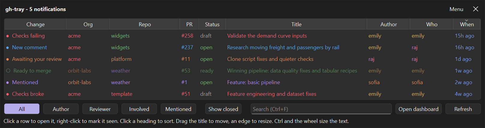

# gh-tray

For when you can't keep track of all your pull requests.

A system tray app that watches your GitHub pull requests, lists what changed, sends a desktop notification when
something needs you, and opens the pull request or a terminal dashboard ([gh-dash](https://github.com/dlvhdr/gh-dash)).
Works on Windows, macOS and Linux.



## Install

You need [uv](https://docs.astral.sh/uv/getting-started/installation/) and [git](https://git-scm.com/). Run it straight
from GitHub, with nothing installed:

```bash
uvx --refresh --from git+https://github.com/SamRWest/gh-tray gh-tray
```

Or install it as a tool, which puts `gh-tray` on your path:

```bash
uv tool install --refresh git+https://github.com/SamRWest/gh-tray
```

Remove it again with `uv tool uninstall gh-tray`.

On first start it checks for the [GitHub CLI](https://cli.github.com/) and gh-dash, and offers to install what is
missing. Sign in with `gh auth login` if you have not already; answer HTTPS to the protocol question. You can check
everything again at any time with `gh-tray setup` (with the `uvx` form above, put `setup` on the end).

## Use

The tray icon shows how many changes you have not seen yet. It is red when something of yours is broken or blocked,
amber for anything else unread, green when there is nothing to do, and grey when the last poll failed.

| On the icon  | Gets you                                                           |
| ------------ | ------------------------------------------------------------------ |
| Hover        | A short status summary                                             |
| Click        | The changes window                                                 |
| Right click  | The menu: dashboard, refresh, mark all seen, settings, log, quit   |
| Middle click | The same menu, on desktops that keep the right click to themselves |

In the changes window:

- Double-click a row to open it on GitHub. Right-click a row to mark it seen or unseen, review it in an IDE, or remove
  the worktree a review made.
- Click a heading to sort. Use the buttons at the bottom to filter, and Ctrl+F to search every column.
- Closed pull requests, and ones you have already reviewed, are hidden until you press **Show closed** or
  **Show reviewed**; each sits on a tinted background so it reads as done.
- Hold Ctrl and scroll to change the text size. Drag the title to move the window and an edge to resize it.
- **Open dashboard** opens gh-dash in a terminal. **Menu** opens the tray menu, for desktops that offer no other way.
- The window has rounded corners and a see-through background where the desktop can draw them, blurred behind on Windows
  11, macOS and KDE. The blur switch and opacity slider in the settings show their effect as you move them.

You are notified when a review is requested of you, your checks break, a reviewer asks for changes, someone mentions
you, or a pull request of yours becomes ready to merge. New comments and merge conflicts are listed but not announced
unless you turn them on. Only changes are reported, never standing state, so an old backlog does not become a wall of
notifications.

### Reviewing in an IDE

**Review in IDE** opens a pull request in its own worktree, so your clone's branch and uncommitted work stay as they
are. Its submenu lists your default IDE first, then the rest of VS Code, PyCharm, IntelliJ IDEA and WebStorm. Three
settings shape it:

- **IDE command** is the default IDE, VS Code unless you change it. Pick a ready-made command, such as
  `pycharm64 {folder}` on Windows, or type your own; `{folder}` stands for the worktree, and goes on the end if you
  leave it out.
- **Code folder** is optional: the folder your clones are in, such as `~/code`.
- **Checkout folder** is where worktrees go, named like `widget-pr7`. It starts as your system's temporary folder.

The tray looks for a clone with a remote for the pull request's repository in the code folder, then the checkout folder,
and clones it into the first of them that is set if there is none. It adds the worktree and checks the pull request out
in it with `gh pr checkout`. A second review of the same pull request brings that worktree up to date instead. If the
IDE command or checkout folder has been cleared, the settings open at the one missing, and the review carries on once
you save.

**Remove local worktree** deletes a pull request's worktree once you are done, and is greyed out until there is one. Git
refuses to remove a worktree holding uncommitted work, and the pull request's branch stays in the clone.

No IDE can be told to open one pull request, so the tray opens the folder and lets the IDE find it:

- VS Code's
  [GitHub Pull Requests](https://marketplace.visualstudio.com/items?itemName=GitHub.vscode-pull-request-github)
  extension looks up the pull request for the checked-out branch when the folder opens, and shows its review comments in
  the editor.
- JetBrains IDEs do the same only once their **Pull Requests** tool window has been opened in that project. Open it from
  **Git | GitHub | View Pull Requests**, and the review comments appear in the editor.
- A pull request from a fork may not be recognised either way; open it from the IDE's own pull request list instead.

## If something goes wrong

**Open log** in the menu shows the log. To watch the tray in a terminal instead, run `gh-tray --foreground`, or add
`--verbose` for every detail. Settings and history live in your platform's application data folder:
`%LOCALAPPDATA%\gh-tray` on Windows, `~/.local/share/gh-tray` on Linux, and `~/Library/Application Support/gh-tray` on
macOS.

On Linux the toolkit also needs the `libxcb-cursor0` package (or your distribution's equivalent); `gh-tray setup` names
the command to install it.

## Developing

Clone the repository and run `uv run poe init` to install the dependencies and pre-commit hooks. `uv run poe` lists the
jobs: tests, type checks, lint, and running the tray from source.
